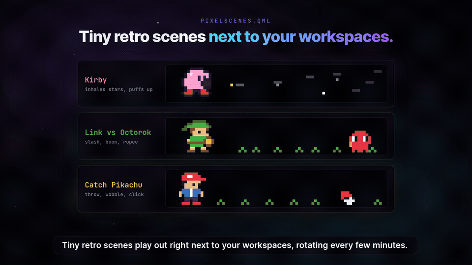
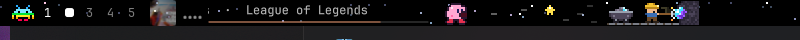

# omarchy-bar ⛏️

> Pixel-art interactive modules for Omarchy (Hyprland / Quickshell), featuring an active AI miner that works while T3 Code agents run and goes to sleep when work is done.

---

## Showcase

<p align="center">
  
</p>

<p align="center"><a href="https://github.com/oliveralerubio/omarchy-bar/releases/latest">▶️ Watch the full 44s demo video (with sound)</a></p>

<p align="center">
  
  
</p>

---

## ✨ Features

- ⛏️ **Pixel Miner (`miner.qml`)**: Real-time T3 Code reactive status module. Swings pickaxe with sparkling crystal vein when AI coding threads are active; stretches/yawns and sleeps peacefully in his minecart with `zzz` when all threads complete. Lists active thread titles on hover! Click anytime to force an instant re-poll.
- 🌌 **Starfield (`starfield.qml`)**: Multi-layered parallax pixel stars across the entire bar background with occasional shooting stars. Driven by the wall clock for perfect sync across multi-monitor setups without jumping on shell restarts.
- 🎮 **Pixel Scenes (`pixelscenes.qml`)**: Rotating classic pixel art scenes (Kirby inhaling stars, Link vs Octorok, catching Pikachu). Clock-synchronized scene rotation with manual advance on click.

---

## 🚀 Quick Start / Installation

Clone the repository and run the idempotent installer script:

```bash
git clone https://github.com/oliveralerubio/omarchy-bar.git
cd omarchy-bar
./scripts/install.sh
omarchy restart shell
```

### What `install.sh` does:
1. Symlinks each module from `modules/*.qml` into `~/.config/omarchy/bar/modules/` (creating timestamped backups in `bar/backups/` if replacing different files).
2. Uses `jq` to safely add `{ "id": "miner", "type": "qml", "pixel": 2 }` into `.bar.layout.left` in `~/.config/omarchy/shell.json` (right after `pixelscenes`, or appended if not present), backing up the original config first.

---

## 🧠 How T3 Code Detection Works

The miner monitors local AI coding activity seamlessly and safely:

- **Pure Read-Only SQLite Probe**: Queries `~/.t3/userdata/statev2.sqlite` using SQLite's read-only URI mode (`file:$db?mode=ro`).
- **Zero Daemons, Zero Tokens**: No background service, no external API keys, no network calls, and no performance overhead. Uses built-in `sqlite3` and `sh`.
- **Anti-Zombie Freshness Filtering**: Ignores abandoned or crashed threads by enforcing an activity cutoff window (`julianday(t.updated_at) > julianday('now', '-N minutes')`).
- **Grace Period Debounce**: Includes a 20-second grace window after threads finish before winding down, preventing the miner from flickering asleep between quick chained tasks.
- **Graceful Degradation**: If `sqlite3` or the T3 database is absent, the probe safely exits with `0` active threads—the miner simply stays resting in his cart.

---

## ⚙️ Configuration

Options are configured in your `~/.config/omarchy/shell.json` inside each module's entry:

### Miner (`miner.qml`)

| Setting | Default | Description |
| :--- | :---: | :--- |
| `pixel` | `2` | Pixel art scaling factor (automatically clamped to bar height). |
| `pollSeconds` | `4` | Polling interval in seconds to query T3 Code active threads. |
| `staleMinutes` | `20` | Thread freshness threshold in minutes (older threads treated as zombies). |

```json
{
  "id": "miner",
  "type": "qml",
  "pixel": 2,
  "pollSeconds": 4,
  "staleMinutes": 20
}
```

### Pixel Scenes (`pixelscenes.qml`)

| Setting | Default | Description |
| :--- | :---: | :--- |
| `pixel` | `2` | Pixel size scaling. |
| `minutes` | `5` | Minutes to display each pixel scene before rotating to the next. |

### Starfield (`starfield.qml`)

| Setting | Default | Description |
| :--- | :---: | :--- |
| `pixel` | `2` | Star pixel size. |
| `speed` | `1` | Parallax drift speed multiplier. |
| `density` | `1` | Star density multiplier. |

---

## 🇪🇸 Resumen en español

**omarchy-bar** es una colección de módulos interactivos en pixel art diseñados para la barra superior de [Omarchy](https://omarchy.org/) (Hyprland / Quickshell).

### Lo más destacado:
- **Minero reactivo a T3 Code (`miner.qml`)**: Trabaja incansablemente picando cristales cuando tus agentes de IA tienen tareas en ejecución (`preparing`, `starting`, `running`, `waiting`). Al terminar todo el trabajo, bosteza y se echa a dormir plácidamente en su vagoneta con su animación de *zzz*. Si pasas el cursor por encima, el tooltip te muestra los títulos de las tareas activas.
- **Cielo estrellado (`starfield.qml`)**: Fondo nocturno con estrellas pixeladas en 3 capas de paralaje y estrellas fugaces esporádicas a lo largo de toda la barra.
- **Escenas clásicas (`pixelscenes.qml`)**: Mini escenas nostálgicas (Kirby, Link y Pikachu) que rotan automáticamente por reloj de pared o con un clic.

### Sin demonios ni claves API:
La detección de T3 Code funciona mediante lecturas puntuales de solo lectura a la base SQLite local (`~/.t3/userdata/statev2.sqlite`). Filtra hilos colgados automáticamente y cuenta con un margen de gracia de 20 segundos para evitar parpadeos si se encadenan agentes.

---

## 📄 License

This project is licensed under the [MIT License](LICENSE) - see the [LICENSE](LICENSE) file for details.
